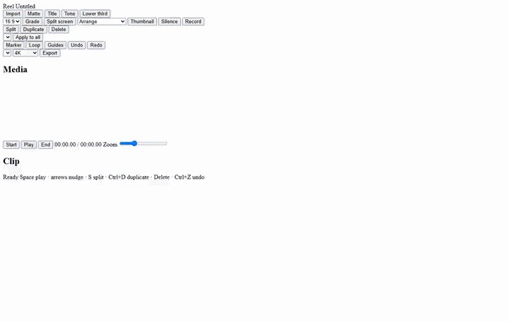
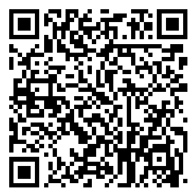

# Reel

Reel is a video editor that runs in the browser. Pictures, video, titles, and audio stay on your machine. Nothing is uploaded.

**Use it:** [https://reel-azure.vercel.app](https://reel-azure.vercel.app)

## Short demo

Import a picture and a video, place the picture over the video, add a title, then play.

[](docs/demo.mp4)

[Open the demo video](docs/demo.mp4)

<video src="docs/demo.mp4" width="720" controls playsinline></video>

## Try the editor

1. Open [the demo](https://reel-azure.vercel.app).
2. Click **Import** and choose pictures, video, or audio.
3. Use **Arrange** for Sequence, Picture over video, Video over picture, or Side by side. Drag a clip between the Video and Overlay lanes when you want them to play together.
4. Drag a picture, video, matte, or title in the preview to move it. Drag a corner to resize it. The Place controls in the clip panel do the same.
5. Audio lands at the playhead, including on top of other audio. Both play together.
6. Press **Space** to play. **S** splits, **Ctrl+D** duplicates, **Delete** removes, **Ctrl+Z** undoes.
7. Choose a size (720p, 1080p, or 4K) and **Export**. MP4, WebM, MKV, M4A, and GIF are offered when this browser can record them. GIF has no audio.

## What you can do

- Sequence pictures and video, or play them at the same time.
- Fit any picture, video, matte, or title anywhere in the frame.
- Add a title, a lower third, a color matte, or a tone.
- Restyle a clip with a remix look, or apply that look to every matching clip.
- Mark, loop, and undo while you edit.

## Features in detail

These tools are part of Reel. Open a section for what it does and how to use it.

<details>
<summary>Picture and video together</summary>

Arrange is the control for how a picture and a video share the frame.

- **Sequence** plays them one after another. The order follows where each clip sits on the timeline.
- **Picture over video** keeps the video full frame and places each picture as a card. Several pictures share that span.
- **Video over picture** keeps the picture full frame and places the video as a card.
- **Side by side** puts the first picture on the left and the first video on the right.
- Drag a clip from the Video lane onto Overlay, or the other way, when you want them playing at the same time. Clips can overlap in time.
- **Split screen** takes the first two clips on the Video track, lines them up in time, and places one on the left and one on the right.

A later Arrange choice restores a picture length that an earlier choice had shortened. Trim a clip when you want a new length.

</details>

<details>
<summary>Fit anything in the frame</summary>

Every picture, video, color matte, and title can sit anywhere, at any size.

- Drag the picture in the preview to move it. Drag a white corner handle to resize it.
- In the clip panel, **Place** has Blend, Scale, Horizontal, and Vertical. Scale runs from a small card up to three times the frame. Horizontal and Vertical can sit inside the frame or hang off the edge.
- Blend is Normal, Multiply, Screen, or Overlay.
- Shape is a rectangle or a circle.
- Frame shape is 16:9, 9:16, 1:1, or 4:5.

</details>

<details>
<summary>Looks, color, and motion</summary>

Select a picture or video, then use the clip panel.

- **Look:** None, Warm, Cool, Mono, Punch, Fade, or Noir.
- **Temperature** shifts the color warmer or cooler.
- **Brightness, Contrast, Saturation, Blur, Opacity.**
- **Fade in** and **Fade out**, up to 3 seconds. Imported pictures already crossfade.
- **Rotate** and **Flip**.
- **Ken Burns** is a slow zoom. **Vignette** darkens the edges of that clip. **Grain** is a light texture on the clip.
- **Chroma key** removes a chosen color. Pick the key color and how strong the key is.
- **Speed** runs from 0.25× to 4×. A video can also set **Speed end**, so the speed changes across the clip.
- **Grade** adds a look across the whole frame, starting as Mono. Select that grade clip to change the look, brightness, contrast, or saturation. Mute the Grade track to turn it off.

</details>

<details>
<summary>Remix looks</summary>

Pick a clip, choose a Remix, or click **Apply to all** for every matching picture or title.

| Look | What it does |
| --- | --- |
| Clean | Clears the look back to a plain picture |
| Golden hour | Warm, a little more color, vignette, slow zoom |
| Moonlight | Cool and slightly darker, with a vignette |
| Silver | Near black and white, stronger contrast |
| Poster | Strong contrast and color |
| Memory | Softer, faded, vignette, slow zoom, longer fades |
| Drift | A light contrast lift with a slow zoom |
| Noir | Dark, high contrast, almost no color, vignette |
| Caption | Turns a title into a lower third |
| Headline | Turns a title into a large outlined line |

</details>

<details>
<summary>Titles and mattes</summary>

- **Title** adds the word Title for 3 seconds. **Lower third** adds a smaller line near the bottom.
- Edit the words, color, and size (12 to 240). Size also follows the clip scale.
- Style is Plain, Lower third, Outline, or Shadow. Motion is None or Rise.
- **Matte** adds a color card. Change its color in the clip panel, then fit it like any other picture.

</details>

<details>
<summary>Audio</summary>

- Import a song or a voice clip. It lands at the playhead, including on top of another audio clip. Both play together.
- **Volume** is per clip.
- **Duck under picture** lowers that audio while a picture or video is on screen.
- **Noise gate** drops the quiet parts while you play.
- **Center cancel** reduces what sits in the middle of a stereo clip.
- **Detach audio** on a video clip moves its sound onto the audio track so you can edit it on its own.
- **Tone** adds a simple tone when you need a sound without a file.
- **Silence** on a selected audio clip drops markers where the sound goes quiet.
- Each track has its own mute.

</details>

<details>
<summary>Timeline</summary>

- Drag a clip to a new time. Drag the ends to trim. Moves snap within 0.12 seconds.
- **Split** (S) cuts the selected clip at the playhead. **Duplicate** (Ctrl+D) copies it. **Delete** removes it.
- **Marker** drops a mark. Click a mark to jump there.
- **Loop** repeats the timeline. **Guides** draws frame guides on the preview.
- **Undo** and **Redo**.
- Zoom the timeline with the slider. Start and End jump to the ends. Space plays and pauses.

</details>

<details>
<summary>Record, thumbnail, and export</summary>

- **Record** asks the browser to capture your screen and microphone, then imports that recording. The browser must allow it.
- **Thumbnail** saves the current preview frame as a PNG.
- Export size is 720p, 1080p, 4K, Source, or Highest. 4K is the default. The long edge is that size.
- Formats this browser can record are offered: MP4 H.264, MP4 HEVC, MP4 AV1, WebM VP9, WebM VP8, WebM AV1, MKV VP9, M4A, WebM audio, and GIF.
- Video and audio exports place each sound at its timeline start. The song is not played through the speakers while Reel records the file.
- GIF is picture only, at most 1280 pixels wide, with no audio.
- A format the browser cannot encode is left out of the list.

</details>

## Run it yourself

```bash
npm install
npm run dev
```

Open [http://localhost:5174](http://localhost:5174).

## Support

This is the same support QR used for LearningPal. Scan it with Google Pay, PhonePe, or Paytm and enter any amount. It is voluntary crowd support: no equity and no promised return.


